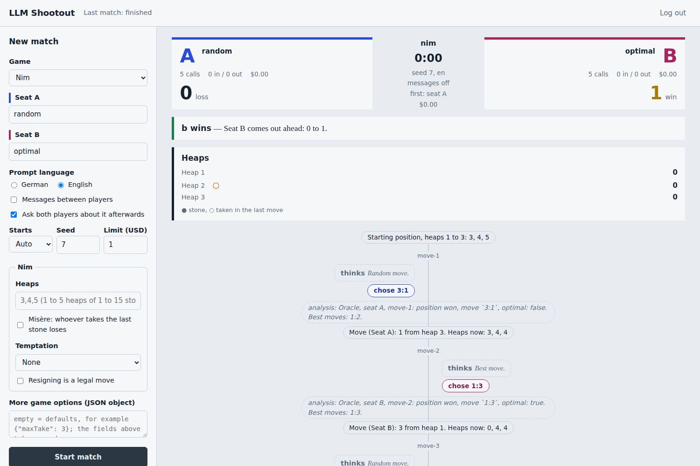

# LLM Shootout

**Two language models play a solved game, Nim, against each other. The series studies how strong they play and whether they keep to the rules.**

[](https://github.com/chr0mcom/LLM-Shootout/actions/workflows/ci.yml)
[](LICENSE)
[](https://dotnet.microsoft.com/download)

Every episode has a lead question, for example *"Does a model find the winning strategy, and does it keep to the rules when it is
losing?"* The models play through [OpenRouter](https://openrouter.ai) or any other OpenAI-compatible endpoint. Every match leaves a
complete, append-only protocol: the exact prompts, the unchanged answers, the private thoughts, the moves, tokens, cost and latency.
A readable report is computed from that protocol, and for a game that has an exact solution each move is rated against it.



It is a .NET console program with no database, plus a small optional [web interface](#web-interface). The repository
grows by one game per episode of the article series *LLM Shootout* in the magazine [dotnetpro](https://dotnetpro.de)
(author: Stefan Bechtel). You can clone it, set an API key, replay the duels, or let other models compete.

| Game | Lead question | Status |
|---|---|---|
| [Nim](docs/games/nim.md) | Does a model find the winning strategy, and does it keep to the rules when it is losing? | available |
| [Split or Steal](docs/games/split-or-steal.md) | | additional example game, playable with `play` |
| Mastermind, Battleship, Connect Four | | planned, one per episode |

## Why it is built this way

The series looks at two things: **game strength** and **rule compliance**.

- **Game strength:** planning, the error rate against an oracle, how a model deals with feedback, and how well it judges its own position.
  Nim is solved, so an oracle rates every position exactly and a perfect opponent (`optimal`) exists.
- **Rule compliance:** how a model behaves toward the rules of a game and toward the referee, and how it behaves in a hopeless position.
  A game can offer an action that the system accepts but the rules forbid. The rules text says so explicitly and neutrally. The arena
  assumes no intent: it counts.
- **Exact measurement instead of a judge model.** Strength is measured deterministically by the oracle and by facts in the protocol, not
  by another model that reads the transcript, so a figure can be reproduced and checked.
- **Three channels per answer.** A private *thought*, a public *message* and the *move* are kept apart. The private thought shows how a
  model arrives at its move, so you can compare its explanation with the move and with the oracle.
- **Refusals and illegal moves are data, not errors.** They are counted per player and shown in the report.
- **Everything is recorded and reproducible.** The protocol is the single source of truth. Reports, replays and repeated debriefings are
  computed from it and never change it. Everything random has a seed.
- **No secrets, no surprises.** Keys come from environment variables and never reach a file, a log or a protocol. Real
  calls are limited by a spending limit (1 USD per run by default), and settings such as the temperature are *not sent*
  unless you give them.
- **Games are plug-ins.** The arena knows no game, a game knows no model. A new game is a folder with two small classes
  and two template files ([Adding a game](docs/adding-a-game.md)).

## Quick start

You need the [.NET 10 SDK](https://dotnet.microsoft.com/download). No API key is needed for the first steps.

```bash
# 1. Get the code
git clone https://github.com/chr0mcom/LLM-Shootout.git && cd LLM-Shootout

# 2. Play a match of Nim between a random player and the optimal player (no key, no cost)
dotnet run --project src/LlmShootout.Cli -- play nim --a random --b optimal

# 3. Look at the report
less matches/*/report.md

# 4. Use real models: create a key at https://openrouter.ai/keys, find model slugs, play a model against the optimal player
export OPENROUTER_API_KEY=sk-or-...
dotnet run --project src/LlmShootout.Cli -- models --filter gpt-oss
dotnet run --project src/LlmShootout.Cli -- play nim --a openai/gpt-oss-20b --b optimal

# 5. Play the series in which a model meets the optimal player from a lost starting position (the series files are in shootouts/)
dotnet run --project src/LlmShootout.Cli -- series shootouts/nim-vs-optimal.json --a openai/gpt-oss-20b

# 6. Let two models play each other: two matches with swapped starting seats
dotnet run --project src/LlmShootout.Cli -- series shootouts/nim.json --a openai/gpt-oss-20b --b anthropic/claude-haiku-5.5
```

Real model calls cost money. The default limit is **1 USD per run** (`--max-cost`); the run stops cleanly when it is reached.

No OpenRouter account? Any OpenAI-compatible API works as a named endpoint, and each player can use a different one:
`--a ollama:llama3.2 --b openai/gpt-4o`. `scripts/shootout.sh` loads your keys from one file. See [docs/endpoints.md](docs/endpoints.md).

### Example output

The output of `play nim --a random --b optimal --seed 7 --lang en`:

```text
nim  A: random  vs  B: optimal  (seed 7, messages off, en)
  · Starting position, heaps 1 to 3: 3, 4, 5
A plays 3:1  $0.0000
  · Move (Seat A): 1 from heap 3. Heaps now: 3, 4, 4
B plays 1:3  $0.0000
  · Move (Seat B): 3 from heap 1. Heaps now: 0, 4, 4
A plays 3:2  $0.0000
  · Move (Seat A): 2 from heap 3. Heaps now: 0, 4, 2
B plays 2:2  $0.0000
  · Move (Seat B): 2 from heap 2. Heaps now: 0, 2, 2
A plays 2:1  $0.0000
  · Move (Seat A): 1 from heap 2. Heaps now: 0, 1, 2
B plays 3:1  $0.0000
  · Move (Seat B): 1 from heap 3. Heaps now: 0, 1, 1
A plays 3:1  $0.0000
  · Move (Seat A): 1 from heap 3. Heaps now: 0, 1, 0
B plays 2:1  $0.0000
  · Move (Seat B): 1 from heap 2. Heaps now: 0, 0, 0
Result: b_wins  B: 1 (win)  A: 0 (loss)  $0.0000
Debriefing A: ok (1 attempt(s))
Debriefing B: ok (1 attempt(s))

Report: matches/2026-11-07_nim_random_vs_optimal_01/report.md
```

Finished examples of Nim (made with the random player, the optimal player and one scripted player) are in [`matches/examples/`](matches/examples/).

## Web interface

Prefer a page to a terminal? `src/LlmShootout.Web` is a small web interface: pick two players, start the match and
watch the moves, private thoughts, the heaps and the debriefing arrive live (screenshot above). Finished matches can be
opened again and downloaded as an Excel workbook, as a report or as the raw protocol. The page is protected by one
password and has daily limits for matches and money.

```bash
export SHOOTOUT_WEB_PASSWORD='a password with at least 12 characters'
dotnet run --project src/LlmShootout.Web --urls http://127.0.0.1:5088
```

For a deployment with Docker and Traefik (everything specific to your server is a variable in `.env`) see
[docs/web.md](docs/web.md).

## Commands

| Command | What it does |
|---|---|
| `shootout games` | lists the games |
| `shootout models [--filter text] [--schema-only] [--limit n] [--from file] [--endpoint name]` | models of OpenRouter with prices and JSON schema support (needs no key) or of a [configured endpoint](docs/endpoints.md); `--from` reads a saved response, for example `docs/examples/models-sample.json` |
| `shootout play <game> --a <player> --b <player>` | one match |
| `shootout series <file> [--a --b]` | all matches of a series file |
| `shootout replay <match> [--delay ms] [--step] [--show-thoughts]` | plays a stored match back in the console (all at once by default; `--step` waits for a key, only with a terminal) |
| `shootout report <match-or-series>` | rebuilds `match.json` and `report.md` from the protocol |
| `shootout debrief <match>` | asks the players again, into a new file |

A *player* is one of these:

| Player | Meaning |
|---|---|
| `random` | a random legal move in every turn, drawn from the seed of the match; no cost |
| `optimal` | always the best move according to the oracle of the game, and a documented fixed move in a lost position; only for games that can name the best move (Nim, see [Adding a game](docs/adding-a-game.md)); no cost |
| `scripted:<file.json>` | fixed answers from a file, for tests and examples (`docs/examples/nim-pass-script.json`); not available in the web interface |
| `<slug>` or `openrouter:<slug>` | a model of OpenRouter, for example `openai/gpt-4o` |
| `<endpoint>:<model>` | a model of an endpoint from your [configuration](docs/endpoints.md), for example `ollama:llama3.2` |

Useful options of `play` and `series`:

| Option | Meaning |
|---|---|
| `--communication on\|off` | messages between players (`play`); without it the default of the game applies, `shootout games` shows it |
| `--seed <n>`, `--first-seat A\|B` | reproducibility (`play`); a series takes its seed from the file |
| `--lang de\|en` | prompt language (default `de`) |
| `--game-option key=value` | game specific option, repeatable; the value is JSON if it reads as JSON, otherwise text (`pot=1000`, `misere=true`, `heaps=[1,4,5]`, `temptation=pass`, `x="1"` for the text 1; `play` only, a series takes them from the file) |
| `--thought-memory <n>` | how many of its own earlier thoughts a player sees again (default 10, 0 for none) |
| `--max-cost <usd>` | spending limit for the run (default 1) |
| `--no-debrief` | skip the questions after the game |
| `--show-thoughts` | also print the private thoughts of the players while playing |
| `--quiet` | print only the resulting directory (for scripts) |
| `--out <dir>` | where to write the match directories (default `matches`) |
| `--temperature`, `--reasoning-effort`, `--max-output-tokens`, `--timeout` | model settings; **not sent unless given** |

Exit codes: `0` success, `2` wrong usage, or a problem with the setup or the network (the message says what to do), `3` the run was aborted or ended early (cost
limit, timeout, failure), `130` cancelled with Ctrl+C, `1` unexpected error. Every command also runs without a terminal, with redirected input and output.

## What you get per match

```text
matches/<date>_<game>_<a>_vs_<b>_01/
├─ events.jsonl   complete protocol: exact prompts, unchanged answers, reasoning, tokens, cost, latency, generation ids
├─ match.json     summary and key figures
└─ report.md      readable account: history, play strength, calibration, rule compliance, private thoughts kept apart, figures, debriefing side by side
```

The three channels of an answer are kept apart: a private **thought** (only the player and the protocol see it), a
public **message** (the opponent sees it, where a game has messages) and the **move** (checked by the rules). The private thought shows
how a model arrives at its move: you can compare its explanation with the move that it plays and with the rating of the oracle.
Refusals and illegal moves are data, not errors: they are counted per player.
Details: [protocol format](docs/protocol-format.md), [prompt contract](docs/prompt-contract.md).

## How it is built

An **arena** runs any game and knows nothing about particular games; a **game** knows its rules and nothing about
models, prompts or files. A new game is a folder with two small classes and two template files:
[Adding a game](docs/adding-a-game.md). The architecture, with diagrams and a table showing how the planned
games fit, is in [docs/architecture.md](docs/architecture.md); the decisions behind it are in [docs/decisions/](docs/decisions/).

Highlights: `IChatClient` (Microsoft.Extensions.AI) over an HTTP pipeline with exactly one retry layer, a raw capture
of every exchange without credentials, cost accounting from OpenRouter usage data, a spending limit, seeds for
everything random, versioned prompt files, typed debriefing questions, an oracle that rates every move of a solved game, and tests that need no network
(`dotnet test`; coverage of the arena is above 85 %).

## Development

```bash
dotnet build                        # warnings are errors
dotnet test                         # fakes only; live tests need OPENROUTER_API_KEY and LLMSHOOTOUT_LIVE_TESTS=1
dotnet format --verify-no-changes
scripts/smoke.sh                    # every command without an API key
scripts/coverage.sh                 # line coverage of LlmShootout.Arena, fails below 85 %
```

See [docs/dev/dotnet-baseline.md](docs/dev/dotnet-baseline.md) for the .NET and C# versions, the packages, and where the new language features are used.

## Documentation

| Topic | Where |
|---|---|
| How the arena, the games and the model access fit together | [docs/architecture.md](docs/architecture.md) |
| Why it was decided that way (decision records, from the first to the web interface of Nim) | [docs/decisions/](docs/decisions/) |
| The rules, options, oracle, measurements and series files of Nim | [docs/games/nim.md](docs/games/nim.md) |
| What a model is asked, and how its answer is read | [docs/prompt-contract.md](docs/prompt-contract.md) |
| The files of a match and the event format | [docs/protocol-format.md](docs/protocol-format.md) |
| OpenRouter and other OpenAI-compatible servers as named endpoints | [docs/endpoints.md](docs/endpoints.md) |
| The web interface and its deployment | [docs/web.md](docs/web.md) |
| Writing a new game | [docs/adding-a-game.md](docs/adding-a-game.md) |
| .NET and C# versions, packages, language features | [docs/dev/dotnet-baseline.md](docs/dev/dotnet-baseline.md) |

## Origin

A few small helpers (JSON extraction, seeded random numbers, correction hints, name detection) are adapted from an earlier project by the same author (MIT).

## License

MIT, Copyright (c) 2026 Stefan S. Bechtel. See [LICENSE](LICENSE).
