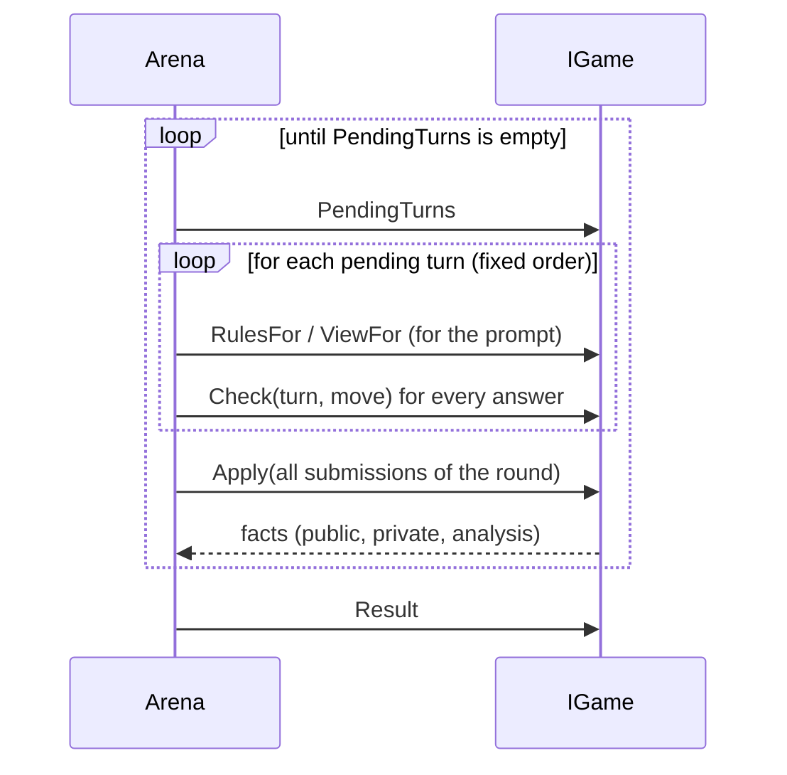

# Adding a game

A new game needs **no change to the arena**. You write the rules, the wording and one registration line. The arena
brings the prompts, the retries, the protocol, the debriefing, the reports, the series and the command line.

The example below is a complete, minimal game: *Matching Pennies*. Both seats choose "heads" or "tails" at the same
time, seat A wins if the choices match, seat B wins if they differ. The same code runs in the test suite
(`tests/LlmShootout.Tests/TestGames/MatchingPenniesGame.cs`), so it is known to work.

## What a game consists of

| Piece | File | Purpose |
|---|---|---|
| `IGameDefinition` | `<Game>Definition.cs` | id, name, wording templates, creates games, extra debriefing questions, default of the setting for messages between players (`DefaultCommunication`, off unless the game says otherwise) |
| `IGame` | `<Game>Game.cs` | the rules and the hidden state of one match |
| Wording | `Prompts/<game>.de.md`, `Prompts/<game>.en.md` | rules, views, instructions, error messages, facts |
| Registration | `GameCatalog.cs` | one line, so readers can see where games are registered |
| (optional) `IGameAnalyzer` | | game specific report sections and the metrics that the series report summarizes per player (`SeriesMetrics`) |

## Step by step

### 1. Create the folder and the wording

```text
src/LlmShootout.Games/MatchingPennies/
├─ MatchingPenniesDefinition.cs
├─ MatchingPenniesGame.cs
└─ Prompts/
   ├─ matching-pennies.de.md
   └─ matching-pennies.en.md
```

Wording is a Markdown file with `## key` sections and `{placeholders}`. Both languages must have the same keys.

```markdown
## rules
Both players secretly choose "heads" or "tails". Seat A wins if the choices match, seat B wins if they differ.

## view
One round is played.

## instruction
Choose now.

## format
Exactly one of "heads" or "tails".

## error.move
"{move}" is neither heads nor tails

## fact.choice
Choice ({who}): {choice}
```

In the facts, `{who}` and `{seat}` are filled in by the arena: "You" or "Your opponent" in a prompt, "Seat A" in the
protocol. Phrase facts so that they work with both ("Choice ({who}): heads"), not with a verb ("{who} chose").

Embed the files in `LlmShootout.Games.csproj`. **`WithCulture="false"` is required**, otherwise MSBuild treats
`.de.md` as a culture-specific resource and puts it into a satellite assembly:

```xml
<EmbeddedResource Include="MatchingPennies\Prompts\*.md" WithCulture="false"
                  LogicalName="LlmShootout.Games.MatchingPennies.%(Filename)%(Extension)" />
```

### 2. Write the rules

```csharp
public sealed class MatchingPenniesGame : IGame
{
    private static readonly string[] Moves = ["heads", "tails"];

    public GameResult? Result { get; private set; }

    public IReadOnlyList<TurnRequest> PendingTurns => Result is not null
        ? []                                              // empty list: the game is over
        : [.. Seat.All.Select(seat => new TurnRequest(    // two entries: simultaneous
            $"choose-{seat}", "choose", seat,
            FieldRule.Forbidden,                          // message
            FieldRule.Required,                           // move
            TemplateRef.Of("instruction"),
            new MoveFormat(TemplateRef.Of("format"), Moves)))];

    public TemplateRef RulesFor(Seat seat) => TemplateRef.Of("rules");

    public TemplateRef ViewFor(Seat seat) => TemplateRef.Of("view");

    public MoveCheck Check(TurnRequest turn, string move)  // pure: never changes state
    {
        var normalized = move.Trim().ToLowerInvariant();
        return Moves.Contains(normalized)
            ? MoveCheck.Ok(normalized)
            : MoveCheck.Reject("not-allowed-value", TemplateRef.Of("error.move", ("move", move)), "\"heads\", \"tails\"");
    }

    public TurnResolution Apply(IReadOnlyList<TurnSubmission> submissions)   // one call per round, all seats together
    {
        var choices = submissions.ToDictionary(s => s.Seat, s => s.Move);     // Move is null if the seat was Exhausted
        var (winner, outcome) = Decide(choices[Seat.A], choices[Seat.B]);
        Result = new GameResult(
            outcome,
            Seat.All.ToDictionary(seat => seat, seat => new SeatResult(seat == winner ? 1 : 0, seat == winner ? "win" : "loss")));
        return new TurnResolution([.. submissions.Select(s => new GameFact(
            "choice", FactAudience.Everyone, s.Seat,
            TemplateRef.Of("fact.choice", ("choice", s.Move ?? "-")),
            new Dictionary<string, string> { ["choice"] = s.Move ?? "-" }))]);
    }

    // The rule for Exhausted: a seat that gave no valid choice loses; if both failed, nobody wins.
    private static (Seat? Winner, string Outcome) Decide(string? a, string? b) => (a, b) switch
    {
        (null, null) => (null, "no_decision"),
        (null, _) => (Seat.B, "no_decision_a"),
        (_, null) => (Seat.A, "no_decision_b"),
        _ => a == b ? (Seat.A, "match") : (Seat.B, "mismatch"),
    };

    public string? SampleLegalMove(TurnRequest turn, SeededRng rng) => Moves[rng.NextInt(Moves.Length)];
}
```

### 3. Write the definition and register it

```csharp
public sealed class MatchingPenniesDefinition : IGameDefinition
{
    public string Id => "matching-pennies";
    public string DisplayName => "Matching Pennies";

    public ITemplateSource Templates { get; } = MarkdownTemplates.FromResources(
        typeof(MatchingPenniesDefinition).Assembly, "LlmShootout.Games.MatchingPennies.matching-pennies", "de", "en");

    public IGame Create(GameSetup setup) => new MatchingPenniesGame();

    public IReadOnlyList<DebriefingQuestion> ExtraQuestions(GameSetup setup) => [];
}
```

```csharp
// GameCatalog.cs: the one place where games are registered
public static IReadOnlyList<IGameDefinition> All { get; } = [new SplitOrStealDefinition(), new MatchingPenniesDefinition()];
```

### 4. Play it

```bash
dotnet run --project src/LlmShootout.Cli -- games
dotnet run --project src/LlmShootout.Cli -- play matching-pennies --a random --b random
```

Prompts, protocol, report, debriefing and series infrastructure work immediately. The debriefing uses the
[standard questions](prompt-contract.md#debriefing); add game specific ones in `ExtraQuestions`.

## How the arena calls your game



- **One entry in `PendingTurns`** is a sequential game, **two entries** are simultaneous: both seats are asked
  against the same state, and nobody sees the other's move before `Apply` has run.
- `Check` is pure. The arena may call it several times for a turn (retries).
- `Apply` gets every answer of the round at once. A seat that used up its attempts arrives with `Status = Exhausted`
  and `Move = null`: **you decide what that means** (a default move, a lost game, a skipped turn) and document it.
- The arena owns the chat and the history. Your game does not keep a history text: it reports **facts**, and the
  arena puts them into the prompts of the seats that may see them.

## Patterns

| You need | How |
|---|---|
| Turn order (alternate, phases) | return one `TurnRequest` at a time, advance your own phase counter in `Apply` |
| Both decide at once | return one `TurnRequest` per seat |
| Several rounds, role swap | state in your game; vary `TurnRequest.Kind` (`offer`, `respond`) and the seat per round |
| Hidden information per seat | keep it in the game, show it in `ViewFor(seat)` or as a `FactAudience.Seat` fact. **Hidden starting state** (dice, a drawn code, a random layout) is returned from `IGame.Start()` as private facts, so it is in the protocol, in later prompts and in the debriefing |
| Reveal | a `FactAudience.Everyone` fact in `Apply` |
| A referee or oracle (Nim) | rate the move inside `Apply` and return a `FactAudience.Analysis` fact; it reaches the protocol but never a prompt |
| Messages together with moves | `Message = Optional` or `Required` and `Move = Required` in the same turn |
| Roles (code maker, code breaker) | read them from `GameSetup.Options` in `Create`, so a rematch with swapped roles is configuration |
| Options (pot, rounds) | parse `GameSetup.Options` in `Create`; throw `GameOptionsException` with a helpful message |
| Randomness (hidden number, dice) | `new SeededRng(setup.Seed)`; never `Random`. A match must be reproducible from its seed |
| Numbers per player over a series | return `SeriesMetric`s from `IGameAnalyzer.SeriesMetrics`: a `Sum`, or a `Ratio` of two counts (sum of the numerators over the sum of the denominators; a denominator of 0 shows as "n/a"). The series report summarizes exactly these, per player over both seats. Without metrics it has no table per player |
| A random player | implement `SampleLegalMove` so that it always returns a legal move; the random player and the `random` debriefing rely on it |

## Checklist

- [ ] `Definition`, `Game`, both template files, embedded resource with `WithCulture="false"`, one line in `GameCatalog`
- [ ] German **and** English templates with the same keys; no wording in C#
- [ ] `ViewFor` shows the current state only, never the opponent's hidden information
- [ ] Every `GameFact` has the right audience (`Everyone`, `Seat`, `Analysis`)
- [ ] `Check` rejects with a stable code, a template for the reason, and the allowed values if there is a short list
- [ ] `Apply` handles `Exhausted`, and the rule is written down in `docs/games/<id>.md`
- [ ] Options are validated and documented; a series file can configure the game
- [ ] Tests (use `MatchHarness` from the test project):
  - rules: every outcome, turn order, locks of fields per phase
  - a match with `RandomPlayer`s runs through the arena and the debriefing
  - **invariants:** no hidden information in a prompt of the wrong seat; the opponent's model name is not in any prompt
  - prompt snapshots (`Snapshot.Verify`) for one turn of each kind
- [ ] A series file in `shootouts/`, a page in `docs/games/`, and a row in the table of [architecture.md](architecture.md)
- [ ] `scripts/smoke.sh` and `dotnet test` are green, `dotnet format --verify-no-changes` is clean

## Where to look next

[Split or Steal](games/split-or-steal.md) is the full example: options, phases, simultaneous decisions, an
exhausted-attempts rule, a game specific debriefing question and report analysis.
