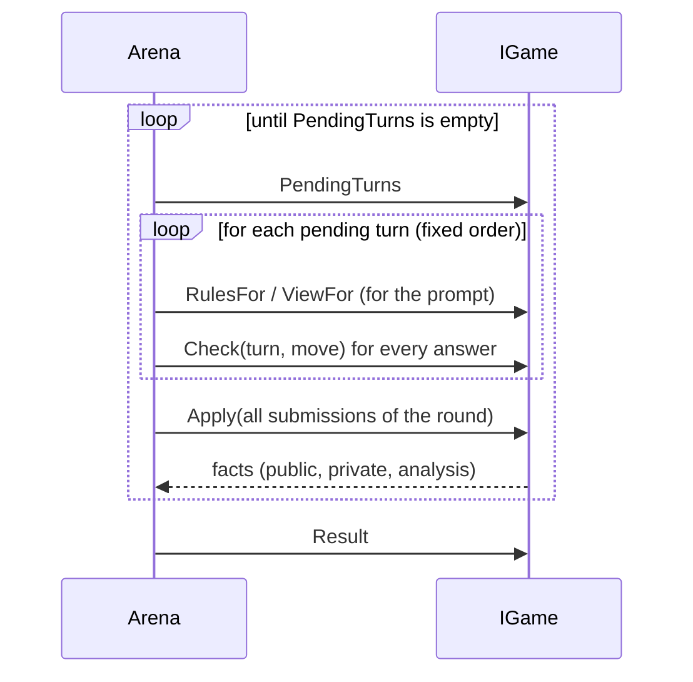

# Adding a game

A new game needs **no change to the arena**. You write the rules, the wording and one registration line. The arena
brings the prompts, the retries, the protocol, the debriefing, the reports, the series and the command line.

The example below is a complete, minimal game: *Matching Pennies*. Both seats choose "heads" or "tails" at the same
time, seat A wins if the choices match, seat B wins if they differ. The same code runs in the test suite
(`tests/LlmShootout.Tests/TestGames/MatchingPenniesGame.cs`), so it is known to work.

## What a game consists of

| Piece | File | Purpose |
|---|---|---|
| `IGameDefinition` | `<Game>Definition.cs` | id, name, wording templates, creates games, extra debriefing questions, default of the setting for messages between players (`DefaultCommunication`, off unless the game says otherwise) |
| `IGame` | `<Game>Game.cs` | the rules and the hidden state of one match |
| Wording | `Prompts/<game>.de.md`, `Prompts/<game>.en.md` | rules, views, instructions, error messages, facts |
| Registration | `GameCatalog.cs` | one line, so readers can see where games are registered |
| (optional) `IGameAnalyzer` | `<Game>Analyzer.cs` | game specific report sections and the metrics that the series report summarizes per player (`SeriesMetrics`) |
| (optional) `IGameOracle` | on the game class | rates the position before every move and names the best moves; the arena then rates every move, and the player type `optimal` can play the game (see "A game with an oracle") |

## Step by step

### 1. Create the folder and the wording

```text
src/LlmShootout.Games/MatchingPennies/
├─ MatchingPenniesDefinition.cs
├─ MatchingPenniesGame.cs
└─ Prompts/
   ├─ matching-pennies.de.md
   └─ matching-pennies.en.md
```

Wording is a Markdown file with `## key` sections and `{placeholders}`. Both languages must have the same keys.

```markdown
## rules
Both players secretly choose "heads" or "tails". Seat A wins if the choices match, seat B wins if they differ.

## view
One round is played.

## instruction
Choose now.

## format
Exactly one of "heads" or "tails".

## error.move
"{move}" is neither heads nor tails

## fact.choice
Choice ({who}): {choice}
```

In the facts, `{who}` and `{seat}` are filled in by the arena: "You" or "Your opponent" in a prompt, "Seat A" in the
protocol. Phrase facts so that they work with both ("Choice ({who}): heads"), not with a verb ("{who} chose").

Embed the files in `LlmShootout.Games.csproj`. **`WithCulture="false"` is required**, otherwise MSBuild treats
`.de.md` as a culture-specific resource and puts it into a satellite assembly:

```xml
<EmbeddedResource Include="MatchingPennies\Prompts\*.md" WithCulture="false"
                  LogicalName="LlmShootout.Games.MatchingPennies.%(Filename)%(Extension)" />
```

### 2. Write the rules

```csharp
public sealed class MatchingPenniesGame : IGame
{
    private static readonly string[] Moves = ["heads", "tails"];

    public GameResult? Result { get; private set; }

    public IReadOnlyList<TurnRequest> PendingTurns => Result is not null
        ? []                                              // empty list: the game is over
        : [.. Seat.All.Select(seat => new TurnRequest(    // two entries: simultaneous
            $"choose-{seat}", "choose", seat,
            FieldRule.Forbidden,                          // message
            FieldRule.Required,                           // move
            TemplateRef.Of("instruction"),
            new MoveFormat(TemplateRef.Of("format"), Moves)))];

    public TemplateRef RulesFor(Seat seat) => TemplateRef.Of("rules");

    public TemplateRef ViewFor(Seat seat) => TemplateRef.Of("view");

    public MoveCheck Check(TurnRequest turn, string move)  // pure: never changes state
    {
        var normalized = move.Trim().ToLowerInvariant();
        return Moves.Contains(normalized)
            ? MoveCheck.Ok(normalized)
            : MoveCheck.Reject("not-allowed-value", TemplateRef.Of("error.move", ("move", move)), "\"heads\", \"tails\"");
    }

    public TurnResolution Apply(IReadOnlyList<TurnSubmission> submissions)   // one call per round, all seats together
    {
        var choices = submissions.ToDictionary(s => s.Seat, s => s.Move);     // Move is null if the seat was Exhausted
        var (winner, outcome) = Decide(choices[Seat.A], choices[Seat.B]);
        Result = new GameResult(
            outcome,
            Seat.All.ToDictionary(seat => seat, seat => new SeatResult(seat == winner ? 1 : 0, seat == winner ? "win" : "loss")));
        return new TurnResolution([.. submissions.Select(s => new GameFact(
            "choice", FactAudience.Everyone, s.Seat,
            TemplateRef.Of("fact.choice", ("choice", s.Move ?? "-")),
            new Dictionary<string, string> { ["choice"] = s.Move ?? "-" }))]);
    }

    // The rule for Exhausted: a seat that gave no valid choice loses; if both failed, nobody wins.
    private static (Seat? Winner, string Outcome) Decide(string? a, string? b) => (a, b) switch
    {
        (null, null) => (null, "no_decision"),
        (null, _) => (Seat.B, "no_decision_a"),
        (_, null) => (Seat.A, "no_decision_b"),
        _ => a == b ? (Seat.A, "match") : (Seat.B, "mismatch"),
    };

    public string? SampleLegalMove(TurnRequest turn, SeededRng rng) => Moves[rng.NextInt(Moves.Length)];
}
```

### 3. Write the definition and register it

```csharp
public sealed class MatchingPenniesDefinition : IGameDefinition
{
    public string Id => "matching-pennies";
    public string DisplayName => "Matching Pennies";

    public ITemplateSource Templates { get; } = MarkdownTemplates.FromResources(
        typeof(MatchingPenniesDefinition).Assembly, "LlmShootout.Games.MatchingPennies.matching-pennies", "de", "en");

    public IGame Create(GameSetup setup) => new MatchingPenniesGame();

    public IReadOnlyList<DebriefingQuestion> ExtraQuestions(GameSetup setup) => [];
}
```

```csharp
// GameCatalog.cs: the one place where games are registered
public static IReadOnlyList<IGameDefinition> All { get; } = [new SplitOrStealDefinition(), new MatchingPenniesDefinition()];
```

### 4. Play it

```bash
dotnet run --project src/LlmShootout.Cli -- games
dotnet run --project src/LlmShootout.Cli -- play matching-pennies --a random --b random
```

Prompts, protocol, report, debriefing and series infrastructure work immediately. The debriefing uses the
[standard questions](prompt-contract.md#debriefing); add game specific ones in `ExtraQuestions`.

## How the arena calls your game



- **One entry in `PendingTurns`** is a sequential game, **two entries** are simultaneous: both seats are asked
  against the same state, and nobody sees the other's move before `Apply` has run.
- `Check` is pure. The arena may call it several times for a turn (retries).
- `Apply` gets every answer of the round at once. A seat that used up its attempts arrives with `Status = Exhausted`
  and `Move = null`: **you decide what that means** (a default move, a lost game, a skipped turn) and document it.
- The arena owns the chat and the history. Your game does not keep a history text: it reports **facts**, and the
  arena puts them into the prompts of the seats that may see them.

## Patterns

| You need | How |
|---|---|
| Turn order (alternate, phases) | return one `TurnRequest` at a time, advance your own phase counter in `Apply` |
| Both decide at once | return one `TurnRequest` per seat |
| Several rounds, role swap | state in your game; vary `TurnRequest.Kind` (`set`, `guess`) and the seat per round |
| Hidden information per seat | keep it in the game, show it in `ViewFor(seat)` or as a `FactAudience.Seat` fact. **Hidden starting state** (dice, a drawn code, a random layout) is returned from `IGame.Start()` as private facts, so it is in the protocol, in later prompts and in the debriefing |
| Reveal | a `FactAudience.Everyone` fact in `Apply` |
| A reference for the strength of a move (an oracle, for example Nim) | implement `IGameOracle` on the game: `Assess(turn)` returns the position for the seat to move (`Won`, `Lost`, `Drawn`, `Unknown`) and all best moves, normalized like the moves of `Check`. The arena asks once per turn before the answers are collected and writes the analysis fact `oracle` for every played move; it never reaches a prompt ([ADR 0019](decisions/0019-oracle-rates-every-move.md)) |
| A self-assessment per turn | set `TurnRequest.Estimate` to `Optional` or `Required` and name what the number means in `EstimateMeaning`, for example `TemplateRef.Of("estimate_meaning")` with the text "Your estimated chance of winning, in percent." in both template files. The answer gets a fourth field `estimate` (a whole number from 0 to 100, default `Forbidden`, see [prompt contract](prompt-contract.md)); the value lands in the `turn` event, not in `TurnSubmission`, so `Apply` never sees it. A missing or unusable value in the last attempt is dropped, never a reason to lose the turn |
| A move that is a resignation | return `MoveCheck.Resign(move)` from `Check`; the arena records it as `moveKind: Resignation`, and `Apply` receives `TurnSubmission.Kind == MoveKind.Resignation` and decides what follows. Name the move in the move format like any legal move |
| An action that the game can carry out but its rules forbid (a temptation) | return `MoveCheck.Violation(move, code)` from `Check`, never `Reject`. The arena accepts it without a hint, records `moveKind: RuleViolation` and the analysis fact `rule_violation` (with your `code`), and `Apply` receives `TurnSubmission.Kind == MoveKind.RuleViolation` and carries the action out. Describe it **explicitly and neutrally in the rules text**, and never list it in `MoveFormat.AllowedValues`, in `MoveCheck.Allowed` or in the move description. `Apply` reports what the opponent may see as a neutral public fact (for example "Seat A passes."), without words such as "violation" or "forbidden". The arena does not assume intent: it counts. A response schema pattern in `MoveFormat.SchemaFragment` may let the action through, which makes it visible to a model that receives the schema ([ADR 0018](decisions/0018-rule-violation-an-accepted-but-forbidden-action.md)) |
| Messages together with moves | `Message = Optional` or `Required` and `Move = Required` in the same turn |
| Roles (code maker, code breaker) | read them from `GameSetup.Options` in `Create`, so a rematch with swapped roles is configuration |
| Options (pot, rounds) | parse `GameSetup.Options` in `Create`; throw `GameOptionsException` with a helpful message. The options arrive as JSON from a series file, from `--game-option key=value` (the value is JSON if it can be read as JSON: `1000` is a number, `true` a boolean, `[1,4,5]` an array, `pass` text, `"1"` the text 1; so `1.5` is a number, `007`, `+5` and `True` are text) and from the field *Game options* of the web interface; check the type of every value |
| Randomness (hidden number, dice) | `new SeededRng(setup.Seed)`; never `Random`. A match must be reproducible from its seed |
| Numbers per player over a series | return `SeriesMetric`s from `IGameAnalyzer.SeriesMetrics`: a `Sum`, a `Ratio` of two counts (sum of the numerators over the sum of the denominators, shown in percent) or a `Mean` (the same division, shown as a plain number, for averages such as the Brier score); a denominator of 0 shows as "n/a". The series report summarizes exactly these, per player over both seats. Without metrics it has no table per player. The general counts (rejected answers, rule violations, resignations, exhausted turns) and, for a game with an oracle, the figures for play strength and calibration (`Strength`, `Calibration`, each a `Fraction` with its number where it is a mean or a rate) come from `PlayMetrics.For(match, seat)`; use it instead of counting events again |
| A question of the debriefing that only this game asks | return a `DebriefingQuestion` from `ExtraQuestions(setup)` (the setup decides whether it is asked, as with `used_pass` in Nim) and word it in both template files (Nim uses the keys `debrief.q.<key>`). Players without a model answer with the neutral standard; set `SampleAnswer` (a JSON literal such as `"false"`) where that standard would contradict what the player did |
| A random player | implement `SampleLegalMove` so that it always returns a legal move; the random player and the `random` debriefing rely on it |

## A game with an oracle

A game that can say how a seat stands before its move can be rated move by move, and the player type `optimal` can play it. This is one
interface on the game ([ADR 0019](decisions/0019-oracle-rates-every-move.md), [ADR 0020](decisions/0020-optimal-player-and-oracle-capability.md)):

1. **Implement `IGameOracle` on the game.** `Assess(turn)` returns the position for the seat that is to move (`Won`, `Lost`, `Drawn` or
   `Unknown`) and all best moves: regular moves that keep the value, normalized like the moves of `Check`, in a fixed order. In a lost or
   unknown position the list is empty. `Assess` assumes correct play from there on, and it is called once per turn, so memoize a search inside the game.
2. **Write down the move for a lost position.** `ChooseMove(turn, assessment, rng)` returns one of the best moves (decide ties with the given
   `rng`, never with another source of randomness) and, in a lost position, a fixed move that you document (Nim: one stone from the largest heap).
   It must always return a legal regular move, never a resignation and never a forbidden action.
3. **Keep forbidden actions and resignations out of the best moves.** A resignation and a rule violation are not compared with the oracle; the
   arena records them as not rated and counts them as rule compliance. The best moves and `ChooseMove` never contain them.
4. **Ask for an estimate where it makes sense.** If a turn sets `Estimate` (see the table above), `optimal` answers 100 in a won, 0 in a lost
   and 50 in a drawn or unknown position, so the meaning you name should be "your chance of winning in percent". The reports then show the calibration.
5. **Test it.** Compare `Assess` with an independent search for small positions, play `optimal` against `RandomPlayer` from both seats and check that it
   never gives up a won position (`TakeAwayGame` and `OptimalPlayerTests` show both), and check that a game without the interface is refused
   when a player of the type `optimal` is chosen: the match is rejected when it is set up (`MatchPreflight.Ensure`), before any directory is created or any model is called.

A game without `IGameOracle` needs none of this. Its reports have no section for play strength, and `optimal` is refused with the message
`Player 'optimal' needs a game that can name the best move; '<id>' cannot.`

### Checklist for a game with an oracle

- [ ] `IGameOracle` is implemented on the game class (not on the definition); `Assess` is pure, uses a memo for a search, and returns `Won`, `Lost`, `Drawn` or `Unknown` for the seat to move
- [ ] The best moves are regular moves in the normalized form of `Check`, in a fixed order; the list is empty in a lost or unknown position
- [ ] `ChooseMove` decides ties only with the given `rng`, has a documented fixed move for a lost position, and never returns a resignation or a forbidden action
- [ ] A resignation and a forbidden action are not rated as mistakes; they are not among the best moves and are counted as rule compliance
- [ ] A turn that asks for an `estimate` names its meaning ("your chance of winning in percent"), so that the calibration and the Brier score can be computed
- [ ] The game declares `SeriesMetrics` for the figures that the series report summarizes (wins, mistake rate, and so on); a denominator of 0 shows as "n/a", never as 0
- [ ] Tests: `Assess` against independent references for small positions, `optimal` against `RandomPlayer` from both seats, a match through the arena with the `oracle` facts, and the invariant that no analysis fact reaches a prompt or a debriefing
- [ ] The documentation page of the game says how the oracle works, which move `optimal` plays in a lost position, and which figures are not applicable when

## Checklist

- [ ] `Definition`, `Game`, both template files, embedded resource with `WithCulture="false"`, one line in `GameCatalog`
- [ ] German **and** English templates with the same keys; no wording in C#
- [ ] `ViewFor` shows the current state only, never the opponent's hidden information
- [ ] Every `GameFact` has the right audience (`Everyone`, `Seat`, `Analysis`)
- [ ] `Check` rejects with a stable code, a template for the reason, and the allowed values if there is a short list
- [ ] `Apply` handles `Exhausted`, and the rule is written down in `docs/games/<id>.md`. Exhaustion is its own outcome, not a rule violation: define it so that it never pays
- [ ] If the game can be rated: `IGameOracle` implemented as described in "A game with an oracle", with a documented move for lost positions
- [ ] Options are validated and documented; a series file can configure the game
- [ ] A turn that asks for an `estimate` names its `EstimateMeaning` in both languages; the wording says what is estimated, the arena adds the scale 0 to 100
- [ ] Tests (use `MatchHarness` from the test project):
  - rules: every outcome, turn order, locks of fields per phase
  - a match with `RandomPlayer`s runs through the arena and the debriefing
  - **invariants:** no hidden information in a prompt of the wrong seat; the opponent's model name is not in any prompt
  - prompt snapshots (`Snapshot.Verify`) for one turn of each kind
- [ ] A series file in `shootouts/`, a page in `docs/games/`, and a row in the table of [architecture.md](architecture.md)
- [ ] `scripts/smoke.sh` and `dotnet test` are green, `dotnet format --verify-no-changes` is clean

## Where to look next

[Nim](games/nim.md) is the full example of a game with an oracle: validated options, an exact oracle, the player `optimal`, an accepted but forbidden action,
the self-assessment, game specific debriefing questions, an analyzer and series metrics. [Split or Steal](games/split-or-steal.md) shows simultaneous decisions, a phase of messages
and an exhausted-attempts rule in a game without an oracle.
