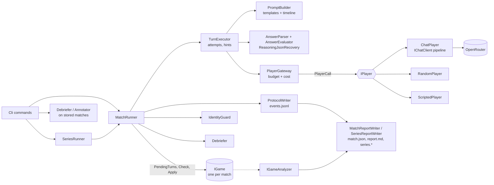
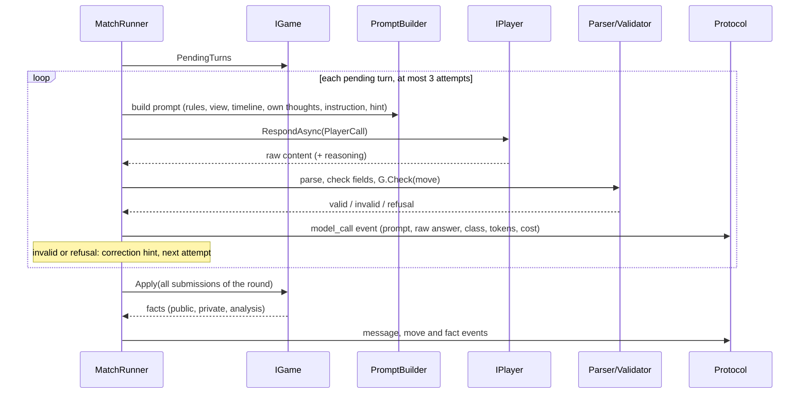
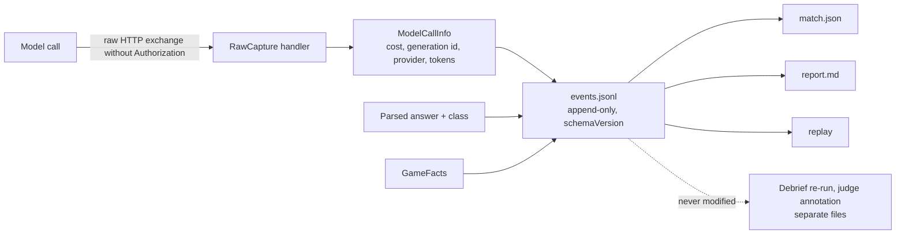

# Architecture

LLM Shootout lets two language models play a game against each other. The **arena** runs the match and knows
nothing about any particular game. A **game** knows its rules and nothing about models, prompts or files.
The decisions behind this are in [`docs/decisions/`](decisions/).

## Projects

| Project | Contents |
|---|---|
| `LlmShootout.Arena` | Game abstraction (`Games/`), match runner (`Matches/`), prompts and templates (`Prompting/`, `Templates/`, `Prompts/`), answer parsing and validation (`Answers/`), protocol (`Protocol/`), debriefing (`Debriefing/`), series (`Series/`), reports (`Reports/`), judge annotations (`Annotation/`), model access (`OpenRouter/`), identity scanner (`Identity/`), players (`Players/`) |
| `LlmShootout.Games` | One folder per game: rules, wording templates, debriefing questions, report analysis. Registered in `GameCatalog` |
| `LlmShootout.Cli` | Commands (`play`, `series`, `games`, `models`, `replay`, `report`, `debrief`, `annotate`), live view, Generic Host setup |
| `LlmShootout.Tests` | Unit tests with fakes, prompt snapshots, the two test-only games |

## Components



The HTTP pipeline behind `ChatPlayer` (see [ADR 0006](decisions/0006-model-access-pipeline.md)):

```text
ChatClientBuilder (logging)
  -> OpenAI chat client (no retries of its own)
       -> HttpClient transport
            -> ResilienceHandler        one retry layer (429, 5xx, connect failures) around one timeout per attempt
            -> OpenRouterRequestHandler adds provider.require_parameters, strict schema, optional reasoning
            -> RawCaptureHandler        stores request and response bodies per call, never headers
            -> network
```

## One turn

A turn is the same loop for every game. The game says who must answer; the arena does everything else.



Simultaneous turns: both seats are asked against the same state, in a fixed order. Nothing is revealed until
`Apply` has run. Messages written in a simultaneous round are published after the round.

## Data path into the protocol



Derived data (a re-run debriefing, a judge rating) is written to separate files. `events.jsonl` is never changed
after the match.

## Extending: how the planned games map onto the abstraction

Every row works without changing the arena. "Turn kinds" are `TurnRequest.Kind` values.

| Game | Turns (`PendingTurns`) | Hidden information | Move format | Communication | Special needs and how they are met |
|---|---|---|---|---|---|
| Split or Steal | `talk` x 6 alternating (message required, move forbidden), then one simultaneous `decide` (move required, message forbidden) | Decisions are hidden until `Apply` | enum `split`/`steal` | Alternating speaker | Simultaneity is the round protocol itself. Reveal and payout are public facts. Exhausted attempts yield the `no_decision` outcome |
| Mastermind | `set-code` (only the code maker, once), then alternating `guess` | Code is private to the code maker (private fact) | four colors, for example `RGBY` | Optional message with each guess | Roles are a game option, so swapped roles are configuration. The game computes feedback and emits it as a public fact. Many turns: the whole timeline goes into every prompt, so a long game grows its prompts (a history limit is a possible later option; see the final report) |
| Battleship | simultaneous `place`, then alternating `shoot` | Each layout is private; own board and shots in `ViewFor` | layout text, coordinates `B7` | Message with each shot | Layout is random per seed or chosen by the model (`place` turn). The board is a pre-rendered text value in the view template |
| Nim | alternating `take` | none | `heap count`, for example `2 3` | Optional | The oracle runs inside `Apply` and emits an `Analysis` fact with the verdict. The report aggregates the error rate per model; no prompt ever shows it |
| Ultimatum game | per round `offer` by the proposer, then `respond` by the other seat; roles swap each round | none | amount / `accept` or `reject` | Optional | Two turn kinds, state of the round inside the game. Rounds and pot are options |
| Liar's dice | per round private dice (private facts, the first round's dice from `IGame.Start()`), then alternating `claim` or `challenge` | Dice are private per seat; revealed by a public fact on a challenge | `3x4` or `challenge` | Bluffing messages | Private facts are shown only to their seat. Reveal is a public fact |
| Human against model (later) | unchanged | unchanged | unchanged | unchanged | `ConsolePlayer : IPlayer` prints the prompt and reads text. Nothing else changes |
| Three seats (later) | list of pending turns has up to three entries | per seat | unchanged | unchanged | A documented later change, not free: add `Seat.C` and a real opponent concept (`Seat.Opponent`, `IdentityGuard`, the debriefing outcome and the report columns are two-seat today), and replace "opponent" in the templates with names. The runner and the turn protocol already loop over `Seat.All` |

Two test-only games, in the test project, prove the claim: a number guessing game (alternating, hidden number,
"higher/lower" feedback) and a role swap game over several rounds. Both run through the unchanged arena.

## Where things are decided

| Question | ADR |
|---|---|
| .NET and C# version | [0001](decisions/0001-dotnet-10-csharp-14.md) |
| Packages, test and coverage tools | [0002](decisions/0002-packages-and-tooling.md) |
| Turn protocol and game interface | [0003](decisions/0003-game-abstraction-check-apply.md) |
| Prompts and timeline | [0004](decisions/0004-stateless-prompts-and-timeline.md) |
| Players, seats, templates | [0005](decisions/0005-players-seats-templates.md) |
| Model access pipeline, what Microsoft.Extensions.AI carries | [0006](decisions/0006-model-access-pipeline.md) |
| One retry layer, timeouts | [0007](decisions/0007-single-retry-layer-and-timeout.md) |
| Cost metering and the spending limit | [0008](decisions/0008-cost-gateway.md) |
