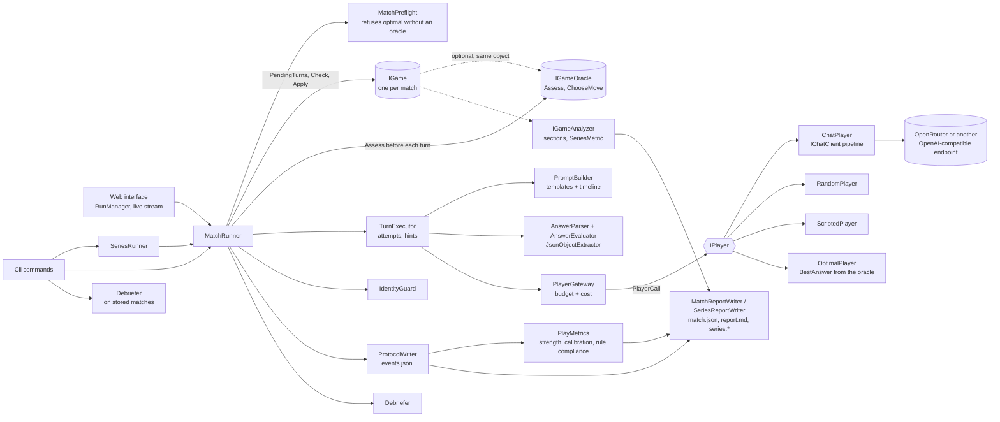
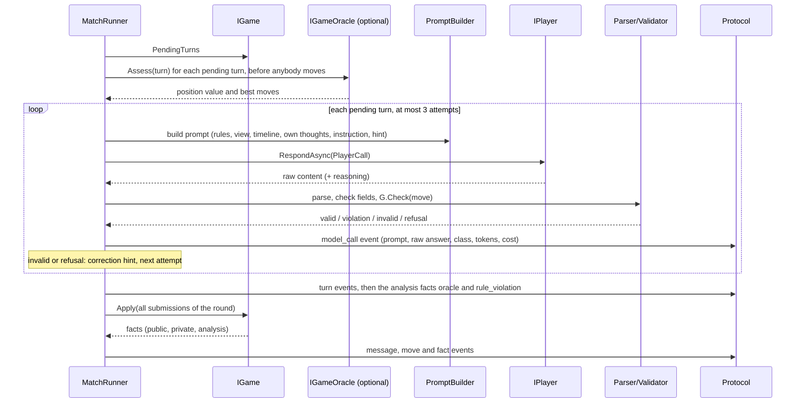
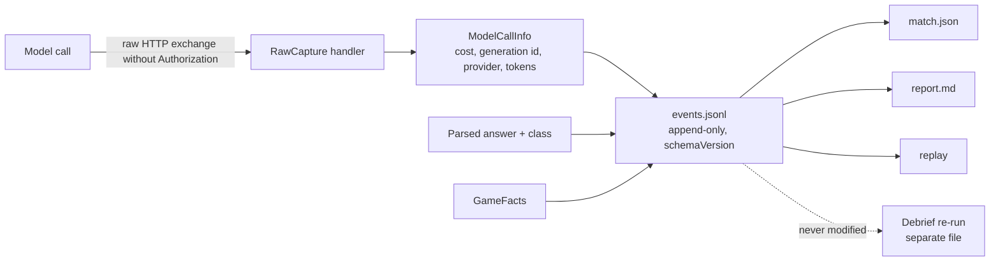

# Architecture

LLM Shootout lets two language models play a game against each other. The **arena** runs the match and knows
nothing about any particular game. A **game** knows its rules and nothing about models, prompts or files.
The decisions behind this are in [`docs/decisions/`](decisions/).

## Projects

| Project | Contents |
|---|---|
| `LlmShootout.Arena` | Game abstraction with the optional oracle and series metrics (`Games/`), match runner and preflight (`Matches/`), prompts and templates (`Prompting/`, `Templates/`, `Prompts/`), answer parsing and validation (`Answers/`), protocol (`Protocol/`), debriefing (`Debriefing/`), series (`Series/`), reports and the figures of play strength and rule compliance (`Reports/`), model access (`ModelAccess/`), identity scanner (`Identity/`), players including `optimal` (`Players/`) |
| `LlmShootout.Games` | One folder per game: rules, wording templates, debriefing questions, oracle and report analysis where a game has them (Nim). Registered in `GameCatalog` |
| `LlmShootout.Cli` | Commands (`play`, `series`, `games`, `models`, `replay`, `report`, `debrief`), live view, Generic Host setup |
| `LlmShootout.Web` | The web interface: login, starting and following a match live, history, Excel export ([docs/web.md](web.md)) |
| `LlmShootout.Tests` | Unit tests with fakes, prompt snapshots, process tests of the command line, in-memory tests of the web interface, small test-only games |

## Components



### Building blocks for game strength and rule compliance

All of them are general: a game opts in, and the arena works unchanged for a game that does not.

| Building block | Where | What it does |
|---|---|---|
| `IGameOracle` | `Games/IGameOracle.cs` | An optional interface that the game class implements. `Assess(turn)` rates the position before a move for the seat to move (`Won`, `Lost`, `Drawn`, `Unknown`) and names the best moves; `ChooseMove` gives `optimal` its move ([ADR 0019](decisions/0019-oracle-rates-every-move.md), [0020](decisions/0020-optimal-player-and-oracle-capability.md)) |
| Analysis facts | `oracle`, `rule_violation` | Facts with the audience `Analysis`: the arena writes them into the protocol, and they never reach a prompt or a debriefing. The rating of every move and every accepted but forbidden action are such facts |
| `MoveCheck` kinds | `Games/MoveCheck.cs` | `Ok`, `Resign`, `Violation` and `Reject`: a regular move, a resignation, an action that the game carries out although its rules forbid it ([ADR 0018](decisions/0018-rule-violation-an-accepted-but-forbidden-action.md)), and an invalid move with a correction hint |
| `OptimalPlayer` | `Players/OptimalPlayer.cs` | The player type `optimal`: it answers with the best move that the arena hands to it as `PlayerCall.BestAnswer`, so no other player has to know the game |
| `MatchPreflight` | `Matches/MatchPreflight.cs` | Refuses a match with `optimal` for a game without an oracle when the match is set up, before a directory is written or a model is called |
| Self-assessment | `TurnRequest.Estimate` | The optional fourth answer field `estimate` (0 to 100) and the protocol version 2 ([ADR 0017](decisions/0017-self-assessment-per-turn-and-protocol-version-2.md)) |
| `PlayMetrics` | `Reports/PlayMetrics.cs` | Computes from the protocol the figures that the report, `match.json` and the series metrics share: rejected answers, rule violations, resignations, exhausted turns, play strength and calibration |
| `SeriesMetric` | `Games/SeriesMetric.cs` | A figure that a game declares for the series report (a sum, a ratio or a mean per player); only declared figures are summarized ([ADR 0014](decisions/0014-series-report-summarizes-declared-metrics.md)) |

The HTTP pipeline behind `ChatPlayer` (see [ADR 0006](decisions/0006-model-access-pipeline.md)):

```text
ChatClientBuilder (logging)
  -> OpenAI chat client (no retries of its own)
       -> HttpClient transport
            -> ResilienceHandler        one retry layer (429, 5xx, connect failures) around one timeout per attempt
            -> EndpointRequestHandler adds strict schema, optional reasoning; for OpenRouter also provider.require_parameters (see endpoints.md)
            -> RawCaptureHandler        stores request and response bodies per call, never headers
            -> network
```

## One turn

A turn is the same loop for every game. The game says who must answer; the arena does everything else.



Simultaneous turns: both seats are asked against the same state, in a fixed order. Nothing is revealed until
`Apply` has run. Messages written in a simultaneous round are published after the round.

The oracle step is skipped for a game without `IGameOracle`. The rating of a move is written before `Apply`, so it describes the position the player
faced, and it is an analysis fact: no prompt shows it. A move that the check accepted as a rule violation is carried out like any other and also leaves a fact.

## Data path into the protocol



Derived data (a re-run debriefing) is written to a separate file. `events.jsonl` is never changed
after the match.

## Extending: how the planned games map onto the abstraction

Every row works without changing the arena. "Turn kinds" are `TurnRequest.Kind` values. The games that are planned one per episode are rated with an oracle where a game can provide one.

| Game | Turns (`PendingTurns`) | Hidden information | Move format | Messages between players | Special needs and how they are met |
|---|---|---|---|---|---|
| Nim (done) | alternating `take` | none | `heap:stones`, for example `2:3`, and `resign` with an option | Off by default | The game implements `IGameOracle`, so the arena rates every move with an `Analysis` fact (`oracle`) and `optimal` can play it. An accepted but forbidden action (`pass`, with the option `temptation`) is a rule violation; the self-assessment `estimate` is on by default. The analyzer adds a section, and the series report summarizes seven declared figures per player. See [Nim](games/nim.md) |
| Split or Steal (an additional example game, playable with `play`) | with messages: `talk` x 6 alternating (message required, move forbidden); then one simultaneous `decide` (move required, message forbidden) | Decisions are hidden until `Apply` | enum `split`/`steal` | Optional message phase with an alternating speaker | Simultaneity is the round protocol itself. Reveal and payout are public facts. Exhausted attempts yield the `no_decision` outcome. The general report shows course, decisions, points and counters; the game has no analysis of its own |
| Mastermind | `set-code` (only the code maker, once), then alternating `guess` | Code is private to the code maker (private fact) | four colors, for example `RGBY` | Optional message with each guess | Roles are a game option, so swapped roles are configuration. The game computes feedback and emits it as a public fact. How well a guess uses the feedback can be measured from the protocol, for example by the number of codes that stay possible. Many turns: the whole timeline goes into every prompt, so a long game grows its prompts (a history limit is a possible later option) |
| Battleship | simultaneous `place`, then alternating `shoot` | Each layout is private; own board and shots in `ViewFor` | layout text, coordinates `B7` | Message with each shot | Layout is random per seed or chosen by the model (`place` turn). The board is a pre-rendered text value in the view template. A shot can be rated by the number of layouts it rules out |
| Connect Four | alternating `drop` | none | a column number from 1 to 7 | Optional | A solved game with a drawn outcome in some positions: the oracle uses `Drawn` as well as `Won` and `Lost`. The board is a pre-rendered text value in the view template. Like Nim it gets `optimal`, the rating of every move and the calibration of the estimate |
| Human against model (later) | unchanged | unchanged | unchanged | unchanged | `ConsolePlayer : IPlayer` prints the prompt and reads text. Nothing else changes |
| Three seats (later) | list of pending turns has up to three entries | per seat | unchanged | unchanged | A documented later change, not free: add `Seat.C` and a real opponent concept (`Seat.Opponent`, `IdentityGuard`, the debriefing outcome and the report columns are two-seat today), and replace "opponent" in the templates with names. The runner and the turn protocol already loop over `Seat.All` |

Test-only games in the test project prove the claim: a number guessing game (alternating, hidden number,
"higher/lower" feedback), a role swap game over several rounds, matching pennies (simultaneous), a sealed-bid game, a game
with a hidden starting state, a take-away game with an oracle, and one that throws. All run through the unchanged arena.

## Where things are decided

| Question | ADR |
|---|---|
| .NET and C# version | [0001](decisions/0001-dotnet-10-csharp-14.md) |
| Packages, test and coverage tools | [0002](decisions/0002-packages-and-tooling.md) |
| Turn protocol and game interface | [0003](decisions/0003-game-abstraction-check-apply.md) |
| Prompts and timeline | [0004](decisions/0004-stateless-prompts-and-timeline.md) |
| Players, seats, templates | [0005](decisions/0005-players-seats-templates.md) |
| Model access pipeline, what Microsoft.Extensions.AI carries | [0006](decisions/0006-model-access-pipeline.md) |
| One retry layer, timeouts | [0007](decisions/0007-single-retry-layer-and-timeout.md) |
| Cost metering and the spending limit | [0008](decisions/0008-cost-gateway.md) |
| Named endpoints for other OpenAI-compatible APIs | [0009](decisions/0009-named-endpoints.md) |
| The web interface | [0010](decisions/0010-web-interface.md) |
| Identity and description of the opponent | [0011](decisions/0011-identity-and-description-of-the-opponent.md) |
| The judge infrastructure is removed | [0012](decisions/0012-judge-infrastructure-removed.md) |
| Standard debriefing and consistent sample answers | [0013](decisions/0013-standard-debriefing-and-consistent-sample-answers.md) |
| The series report summarizes only the metrics a game declares | [0014](decisions/0014-series-report-summarizes-declared-metrics.md) |
| Default of the setting for messages between players, per game | [0015](decisions/0015-default-of-the-messages-setting-per-game.md) |
| JSON game options on the command line and in the web interface | [0016](decisions/0016-json-game-options-in-cli-and-web.md) |
| Self-assessment per turn, protocol version 2 | [0017](decisions/0017-self-assessment-per-turn-and-protocol-version-2.md) |
| Rule violation: an accepted but forbidden action | [0018](decisions/0018-rule-violation-an-accepted-but-forbidden-action.md) |
| The oracle that rates every move | [0019](decisions/0019-oracle-rates-every-move.md) |
| The player type `optimal`, the oracle as a capability of the game, refusal at set-up | [0020](decisions/0020-optimal-player-and-oracle-capability.md) |
| Nim: options, move format, schema pattern, endings | [0021](decisions/0021-nim-options-move-format-and-endings.md) |
| Nim: oracle, rule for a lost position, debriefing questions, analyzer, series metrics | [0022](decisions/0022-nim-oracle-analyzer-and-series-metrics.md) |
| Web interface: Nim fields, heap display, analysis facts for the viewer | [0023](decisions/0023-web-interface-nim-fields-heaps-and-analysis-facts.md) |
